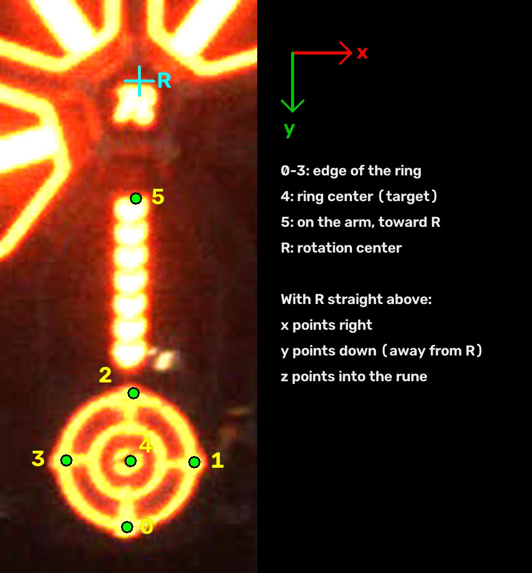

# Lecture 4 Homework: Solve the Power Rune

In class you used `solvePnP` to find where an **armor plate** is. Now you'll do the same thing for the **Power Rune** (the big spinning target in the middle of the field).

- **Task 1:** Find where the **target** (the center of the glowing ring) is in 3D, and plot it.
- **Task 2:** From that, work out where the rune's **rotation center** (the "R" logo) is, and plot that too.

You don't need a camera. Everything runs on the test video in `assets/test.avi`.

---

## Step 1: Install the libraries

You need Ubuntu 22.04 or 24.04. Run:

```bash
sudo apt update
sudo apt install build-essential cmake python3-venv \
    libopencv-dev libeigen3-dev libfmt-dev libspdlog-dev \
    nlohmann-json3-dev libusb-1.0-0-dev
```

## Step 2: Install OpenVINO (runs the detection model)

The easiest way is with pip, inside its own Python environment:

```bash
python3 -m venv ~/openvino-env
~/openvino-env/bin/pip install openvino
```

Then print the folder CMake needs. **Copy what it prints.** You'll use it in Step 4.

```bash
~/openvino-env/bin/python -c "import openvino, os; print(os.path.join(os.path.dirname(openvino.__file__), 'cmake'))"
```

It will look something like `/home/you/openvino-env/lib/python3.12/site-packages/openvino/cmake`.

> Already installed OpenVINO another way (for example with apt)? That works too. Just use your own install's `cmake` folder in Step 4.

## Step 3: Install PlotJuggler (draws live graphs)

```bash
sudo snap install plotjuggler
```

## Step 4: Build and run the example

From **this folder** (`lecture4/homework`):

```bash
mkdir -p build && cd build
cmake .. -DOpenVINO_DIR=PASTE_THE_FOLDER_FROM_STEP_2_HERE
make -j4
cd ..
./build/video
```

- You should see the video play with colored dots on the glowing target.
- **Always run the program from the `lecture4/homework` folder**, not from `build/`. It looks for `assets/test.avi` and the model in `assets/` from there.
- Press **Esc** to quit.

## Step 5: Learn what the detector gives you

`detector.detect(img)` returns a list of `FanBlade`s (usually 0 or 1). Each one has:

- `points`: **6 keypoints** in pixels
- `center`: the same as `points[4]`, the ring center



| Keypoint | What it is | Where it is on the real rune (meters) |
|---|---|---|
| 0 | Edge of the ring, far side from R | ( 0, 0.127, 0) |
| 1 | Edge of the ring, side | ( 0.127, 0, 0) |
| 2 | Edge of the ring, side closest to R | ( 0, −0.127, 0) |
| 3 | Edge of the ring, other side | (−0.127, 0, 0) |
| 4 | **Ring center (the target)** | ( 0, 0, 0) |
| 5 | On the arm, toward R | ( 0, −0.480, 0) |
| R | **Rotation center** (not a keypoint) | ( 0, −0.700, 0) |

- These positions use a frame with its **origin at the ring center**. It's the same idea as the armor plate in slide 5: if R is straight above the ring, **x points right**, **y points down**, and **z points into the rune**.
- The rune is flat, so **z = 0** for every point.
- The numbers come from the positions the detection model was trained on (from the original team's code).

## Step 6: Task 1, find the target

Write your code in `tasks/buff_solver.hpp` and `tasks/buff_solver.cpp`. You're free to change the empty `solvePnP()` function however you like.

1. Make a `std::vector<cv::Point3f>` of 3D points using the table above.
2. Make a `std::vector<cv::Point2f>` from `fanblade.points`, **in the same order**.
3. Camera settings for `test.avi` are in `tasks/camera_info.hpp` (`auto_buff::camera_matrix` and `auto_buff::distort_coeffs`).
4. Call `cv::solvePnP`. The rune is flat, so `cv::SOLVEPNP_IPPE` is a good choice.
5. `tvec` is the ring center in the camera frame (meters), because the ring center is your origin.

**Hints**

- You can use only points 0–3, but using **all 6** gives steadier results, because point 5 is far from the others.
- A good shape for your class is a function that takes a `FanBlade` and saves the answers as member variables.

## Step 7: Task 2, find the rotation center (R)

- The R logo is **0.700 m from the ring center**, in the direction of keypoint 5. That's `(0, −0.700, 0)` in your rune frame.
- `solvePnP` tells you how the rune frame is turned (`rvec`) and where it is (`tvec`) compared to the camera.
- Use `cv::Rodrigues` to turn `rvec` into a rotation matrix. Then move the R point from the rune frame into the camera frame:

  `point_in_camera = rotation_matrix × point_in_rune_frame + tvec`

## Step 8: Plot it in PlotJuggler

Since you most likely don't have the team's Hikrobot camera, put your plotting code in **`src/video.cpp`**, which reads `test.avi`. It already has a `plotter` you can reuse:

```cpp
nlohmann::json data;
data["target/x"] = /* your target x */;
data["target/y"] = /* your target y */;
data["target/z"] = /* your target z */;
data["r_center/x"] = /* your R x */;
// ...and so on
plotter.plot(data);
```

Then in PlotJuggler:

1. Under **Streaming**, pick **UDP Server** and click **Start**.
2. Keep the defaults (port **9870**) and click **OK**.
3. Run `./build/video`. Your names (`target/x`, ...) appear under **Timeseries List**.
4. Drag them into the plot area on the right.

## Step 9: Check your answer

**The camera in `test.avi` is handheld and moves around.** So your plots will **not** be flat lines, even if your code is perfect. Check your work like this instead:

1. **Draw R on the video.** Use `cv::projectPoints` with your `rvec`/`tvec` to turn your 3D R point back into a pixel, and draw it with `cv::circle`. **It should sit right on the "R" logo in every frame**, even when the target jumps to a different arm.
2. **Look at your plots.**
   - **Distance (z):** the target and R should both be roughly **10–11 m** away.
   - **Shape:** the target's x/y should swing around as the rune spins. R's x/y should only drift slowly as the camera moves.
   - **Jitter:** some jumpiness is normal. z is the jumpiest (about ±10 cm), because the target is small and far away.
3. **A few frames will be wrong.** Now and then the model marks something that isn't the target, like a person walking by. That's a detection problem, not your solver.

> **If you test with a real camera:** keep the camera completely still. Then R's plot **should** be almost a flat line, which is how the team checks this in person.

## Common problems

| What you see | What to do |
|---|---|
| `Could NOT find OpenVINO` | The `-DOpenVINO_DIR=...` folder is wrong. Redo Step 2 and copy the exact path. |
| `Could not open the video file!` | Run `./build/video` from the `lecture4/homework` folder, not from `build/`. |
| `undefined reference to ...Buff_Solver...` | Any new `.cpp` file you add must be listed in `tasks/CMakeLists.txt` (`buff_solver.cpp` already is). |
| Nothing appears in PlotJuggler | Click **Start** in PlotJuggler *before* running your program, and make sure it's on **UDP Server**, port 9870. |
| R is nowhere near the logo | Check that your 3D points and `fanblade.points` are in the **same order**, and that R is at `(0, −0.700, 0)`, not `+0.700`. |

## What to submit

Push to your GitHub repo:

- Your `tasks/buff_solver.hpp`, `tasks/buff_solver.cpp`, and `src/video.cpp`
- A screenshot of your **PlotJuggler** plots (target x/y/z and R x/y/z)
- A screenshot of the video with **your R dot on the R logo**

Then send the link to your vision lead.
